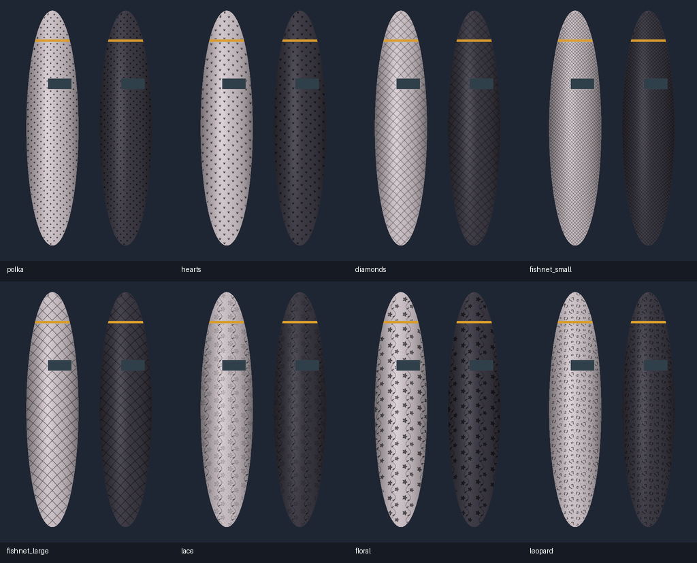
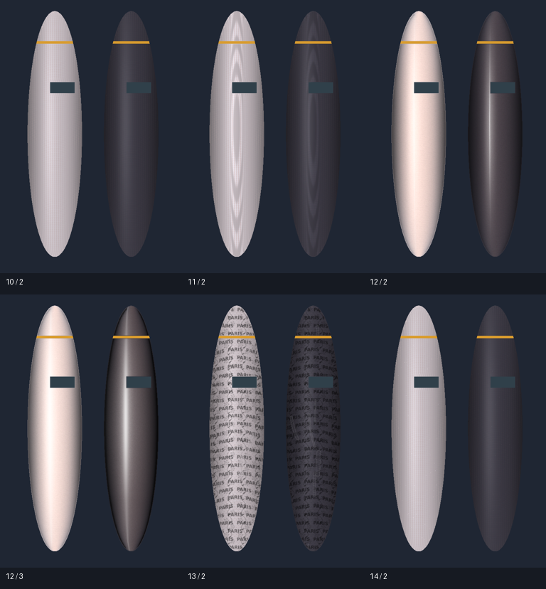
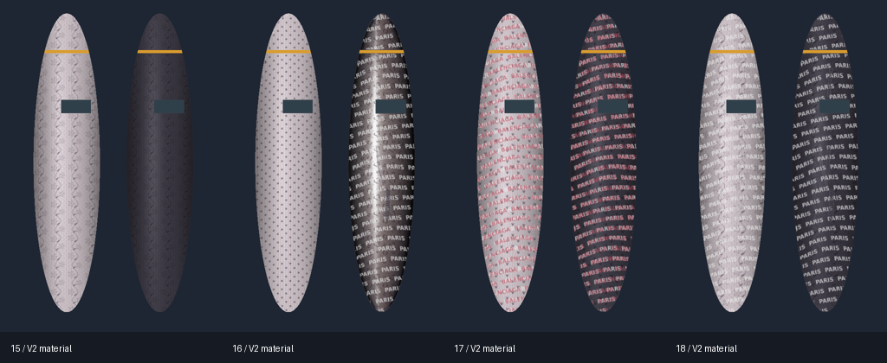

# ComfyUI-StockingTexture

独立的 ComfyUI 丝袜纹理、引导编辑与有序材质插件，从 ComfyUI-ToolBox 拆分；无需安装 ToolBox。

## 安装

将本项目放到 `ComfyUI/custom_nodes/ComfyUI-StockingTexture`，使用 ComfyUI 的 Python 执行：

```bash
python -m pip install -r requirements.txt
# 按需安装 SAM/深度模型、PSD 支持
python -m pip install -r requirements-stocking-models.txt
python -m pip install -r requirements-stocking-psd.txt
```

重启 ComfyUI 并刷新页面。节点位于“南风节点/丝袜纹理”，主节点类型为 `NFStockingTexture`；保留现有节点参数、渲染逻辑和 `/toolbox/stocking` 编辑接口。

本项目包含全部示例、编辑器、测试、字体和上游许可证。模型按需准备，不在启动时自动下载。

## 开发与测试

```bash
python -m pip install -r requirements-dev.txt
python -m pytest --import-mode=importlib --confcutdir=tests tests
node --test tests/*.test.mjs
```

部署已有测试容器：`bash scripts/deploy_stocking_to_container.sh [容器名]`。

## 丝袜纹理与引导编辑

为图片中的丝袜添加沿腿部弧度贴合的织物纹理、花纹、英文印花和钩丝效果。推荐使用 `NFStockingTexture` 一体化节点，在同一窗口完成部位选区、走向编辑和纹理预览。

### 功能介绍

| 功能 | 说明 |
| --- | --- |
| 一体化编辑 | 「部位／走向／纹理」三页完成编辑；打开窗口只准备必要输入，无需先运行完整工作流 |
| 选区与修边 | 支持画笔、橡皮、外部 MASK，以及可选 SAM ViT-B 点选；候选范围可预览、应用或取消 |
| SAM3 语义识别 | 可选连接 Easy-Sam3 image 模型加载器，按 `stockings` 等文本逐图识别部位，再手工修边 |
| 走向与深度 | 手绘横向引导控制纹理弧度；缺少手绘引导时可生成基础走向，可选灰度深度辅助贴合与隔开 |
| 14 种样式 | 原有细线、针织、斜单线、加濑风、油光（试验）；新版增加透肤自适应 Coil 线圈，以及波点、爱心、菱格、小渔网、大渔网、蕾丝、花卉、豹纹 |
| 扩展渲染 | 支持 Coil 线圈、深度摩尔纹及连续油光，可切换渲染版本；旧工作流默认保持原输出 |
| 部位编辑与镜像 | 手画切开、自动贴线分割、合并、清空、走向镜像、指针删除和横／纵引导显示 |
| 材质预设与恢复 | 按用户保存材质预设；独立自动恢复草稿，仍需保存并关闭才写入节点 |
| PSD 互通 | 可选 psd-tools 支持 PSD/PSB 导入、引导 PSD 导出，以及成品和柔和透明 PNG |
| 花纹表现 | 新花纹支持「织物／印花」切换，大小、旋转、颜色和不透明度独立可调 |
| 英文印花 | 提供 BALENCIAGA、PARIS 预设及自由输入，支持最多 128 个可打印 ASCII 字符；字号、行列间距、方向、颜色和不透明度可调 |
| 钩丝与抽丝 | 支持随机、手工或混合生成钩丝和梯状抽丝，可调整数量、长度、宽度和强度；手工路径支持删除、撤销和重做 |
| 实时预览与保存 | 支持整体、100%/200% 细节及原图分界对比；统一窗口「保存并关闭」写入工作流，「取消」放弃草稿 |
| 图片绑定与批处理 | 手工选区和损伤按图片内容绑定，避免换图误用；批次只输出成功图像，保留输入/输出索引报告 |
| 图层与诊断 | 输出成品、丝袜图层、alpha、部位遮罩、诊断及报告；图层可精确叠回对应原图，遮罩外原始像素保留 |

手工选区与纹理渲染无需扩散模型、SAM 或深度模型；SAM/SAM3 和深度辅助按需连接。英文印花与损伤默认关闭，油光为试验样式。渔网、蕾丝及抽丝效果基于原图渲染，不生成新的裸肤底图。

保留 `NFStockingEditor → NFStockingSolve → NFStockingRender` 高级分步流程，兼容原有工作流。安装依赖、模型准备、参数及输出说明见 [完整使用文档](docs/stocking_texture.md)。

### 快速上手

1. 将插件放入 `ComfyUI/custom_nodes/ComfyUI-StockingTexture`，按 [安装说明](docs/stocking_texture.md#安装和升级) 安装依赖，然后重启 ComfyUI 并刷新页面。
2. 将 [公开示例素材](examples/stocking_texture/assets) 中的 `tb_stocking_demo*.png` 复制到 `ComfyUI/input/`。PSD 示例另需复制 `tb_stocking_guides.psd`，并安装 `requirements-stocking-psd.txt`。
3. 把下表中的普通 `.json` 工作流拖入 ComfyUI。初次体验建议选择 **06-八种花纹总览**，已有合成图选区，无需准备识别或深度模型。
4. 点击主节点的「编辑与预览」，选择样式、调整参数或绘制损伤；「保存并关闭」后运行工作流生成结果。替换为自己的图片后，需重新建立该图片的选区。

自行搭建最简流程：`LoadImage → NFStockingTexture → PreviewImage / SaveImage`。图层合成时，一体化节点的 `source_images` 输出与成功处理的图片一一对应，可用作原图输入。

### 示例工作流

以下链接为可直接加载的 ComfyUI `.json` 工作流；同目录中的同名 `.api.json` 用于 API 队列调用。示例使用项目生成的公开合成图片，推荐的一体化与效果示例默认通过 PreviewImage 预览，不自动保存成品文件。

| 工作流 | 用途与准备 |
| --- | --- |
| [01-手工点选与统一编辑](examples/stocking_texture/unified/01-手工点选与统一编辑.json) | 画笔选区、走向与统一纹理编辑；默认选区为空，需要先编辑选区 |
| [02-SAM3语义识别与点选修边](examples/stocking_texture/unified/02-SAM3语义识别与点选修边.json) | SAM3 文本识别，再用 SAM ViT-B 点选修边；需准备对应本地模型 |
| [03-深度辅助与逐图批处理](examples/stocking_texture/unified/03-深度辅助与逐图批处理.json) | 两张图片组成真实批次，逐图识别并使用 Small 深度辅助；需 SAM3、SAM ViT-B 和 Small 深度模型 |
| [04-五种纹理并排对比](examples/stocking_texture/unified/04-五种纹理并排对比.json) | 比较原有五种织物纹理，共用图片与识别结果；需对应识别模型 |
| [05-图层合成与效果诊断](examples/stocking_texture/unified/05-图层合成与效果诊断.json) | 对应原图合成、透明图层及诊断预览；需对应识别模型 |
| [06-八种花纹总览](examples/stocking_texture/effects/06-八种花纹总览.json) | 并行预览八种新增花纹，内置合成图选区，无需识别/深度模型 |
| [07-英文错行印花](examples/stocking_texture/effects/07-英文错行印花.json) | BALENCIAGA 英文重复印花，可修改文本和排列参数；无需识别/深度模型 |
| [08-钩丝与梯状抽丝](examples/stocking_texture/effects/08-钩丝与梯状抽丝.json) | 随机损伤与预设手工路径组合，可继续编辑；无需识别/深度模型 |
| [09-花纹文字损伤组合](examples/stocking_texture/effects/09-花纹文字损伤组合.json) | 爱心花纹、PARIS 字样和损伤叠加；无需识别/深度模型 |

线圈、油光、图层与 PSD 示例（无需识别模型）：

| 工作流 | 用途 |
| --- | --- |
| [10-Coil透肤线圈](examples/stocking_texture/upstream/10-Coil透肤线圈.json) | 新版线圈与柔和图层 |
| [11-深度摩尔纹](examples/stocking_texture/upstream/11-深度摩尔纹.json) | 使用公开合成深度图调整强度与面积 |
| [12-新旧油光对比](examples/stocking_texture/upstream/12-新旧油光对比.json) | 原图、兼容版油光与新版油光 |
| [13-柔和图层与组合效果](examples/stocking_texture/upstream/13-柔和图层与组合效果.json) | 蕾丝、PARIS、损伤、透明 PNG 和重合成 |
| [14-PSD引导导入导出](examples/stocking_texture/upstream/14-PSD引导导入导出.json) | 读入引导并在 output 保存新的引导 PSD |
| [04-六种纹理并排对比](examples/stocking_texture/unified/04-六种纹理并排对比.json) | 原图与六种基础样式；需对应识别模型，旧五样式示例保留 |

高级分步例子：[手工引导](examples/stocking_texture/manual.json)、[外部遮罩与深度](examples/stocking_texture/external-depth.json)、[SAM 点选](examples/stocking_texture/sam.json)、[批次渲染](examples/stocking_texture/batch.json)。这些高级例子包含 SaveImage 节点，执行前可调整保存位置。

### 效果预览

下图为八种新增花纹在公开合成图片上的实际渲染结果：





### 有序图层与部位材质

基础织物与花纹可独立组合，每套材质最多 16 个有序花纹/英文文字层，支持复制、启停和排序，损伤最后处理。左右腿可继承全局或覆盖不同材质；连接 `NFStockingMaterial` 后全局参数显示解析值并只读，部位仍可编辑。V1 工作流、预设和十四个旧样式入口兼容，读取不改写，显式保存迁移至 V2；取消放弃编辑。详见 [V2 使用说明](docs/stocking_texture.md#有序材质图层与部位覆盖v2)。

| 新公开工作流 | 展示内容 |
| --- | --- |
| [15-Coil与蕾丝组合](examples/stocking_texture/materials/15-Coil与蕾丝组合.json) | 基础织物＋独立花纹层 |
| [16-左右腿独立材质](examples/stocking_texture/materials/16-左右腿独立材质.json) | Coil＋波点与油光＋豹纹/PARIS |
| [17-有序多层文字](examples/stocking_texture/materials/17-有序多层文字.json) | 爱心＋PARIS＋BALENCIAGA |
| [18-材质配置节点连线](examples/stocking_texture/materials/18-材质配置节点连线.json) | 五个新配置节点与只读全局材质 |

English: six base fabrics can be combined with up to 16 ordered procedural pattern/text layers and final damage. Regions inherit or override the global material. The five composable configuration nodes connect through the optional material input; linked global settings are read-only while region overrides remain editable. V1 pixels and workflow ports remain compatible. See [V2 usage](docs/stocking_texture.md#有序材质图层与部位覆盖v2).



### 原生高清多场景示例

[19-Qwen21原生高清素材生成](examples/stocking_texture/hd/19-Qwen21原生高清测试素材生成.json) 使用本地 Qwen 2.1 生成原生 2048×2048 图片，覆盖二次元/写实、站姿/跪姿/坐姿和连裤袜/大腿袜。[20-高清多场景大工作流](examples/stocking_texture/hd/20-高清多场景丝袜纹理与图层对比.json) 支持多场景材质分支对比，保存完整高清结果与场景总览。模型及大图片留在本地，详见 [高清示例说明](examples/stocking_texture/hd/README.md)。
